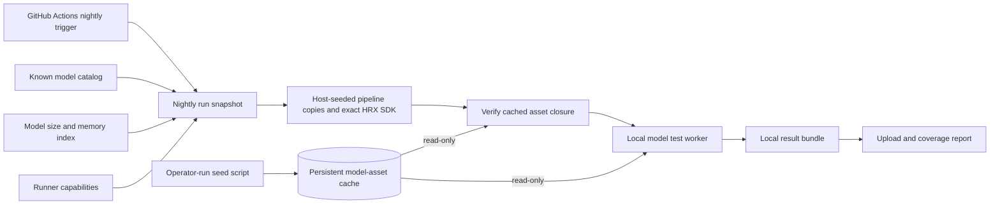

# Hosted model nightly CI design

Status: **Draft for discussion**. This repository is a workspace for developing
the model-test design. The separate [runner bootstrap](runner-bootstrap.md)
provides host setup and a manual storage smoke check; it does not implement the
nightly model tests. The [single-model skeleton](single-model-e2e.md) adds a
fixture stage contract and manual hookup; real adapters remain pending. Update
this document as requirements and decisions resolve.

The first implementation epic is [one model end to end](acquisition-spike.md):
manual asset/pipeline seeding, fresh HRX inputs, read-only CI consumption, real
model readiness, bounded inference and owned cleanup. It assumes the operator
selects a compatible host/model. The later
[hardware-specific seed list](acquisition-spike.md#hardware-specific-model-list-and-seeding)
automates suitability checks and does not block this basic end-to-end milestone.
For this epic, use one known compatible HRX release and pinned pipeline to
validate the testing infrastructure. The selected SDK release is downloaded into each run and is not persistently
cached. Fresh run directories do not imply newer versions; release upgrades and candidate-build testing are separate work.
The [restriction inventory](platform-restrictions.md) records the comparisons
needed between model/pipeline requirements and the actual platform/runtime.

The system acquires a known set of published Hugging Face model packages, retains
GGUFs and other assets locally between runs, executes nightly serving checks, and
uploads results that show model and feature coverage. A scheduled GitHub Actions
workflow triggers the nightly, which executes on GitHub Actions runners. The
initial proposal uses one dedicated hardware runner; later versions add a head
node coordinating workers on different hardware.

## Confirmed direction

- Test the published Hugging Face model packages directly. No Loomify generation
  or model-conversion pipeline is part of this system.
- Exercise all models in the agreed catalog and make missing coverage visible.
- Use model cards to identify the selected programs, checkpoint assets, tokenizer
  and service/preset configuration.
- Cache large assets locally across runs; acquisition should support a prefetch
  phase instead of redownloading the corpus each night.
- Run nightly validation and upload results for coverage tracking.
- Use GitHub Actions for the nightly trigger and runner execution.
- Run acquisition and model-test workloads in Docker containers, with explicit
  GPU access, storage mounts and a defined containment boundary.
- Use a separate caching/prefetch run with writable persistent storage, followed
  by test containers with read-only access to verified cached inputs. Limit
  acquisition to the assets required by the planned model/preset selections.
- Initially, a person seeds the model assets using a simple script. CI mounts
  that cache read-only. Operators also seed original pipeline inputs explicitly;
  each CI run stages exact verified copies and acquires its Loom/HRX build.
- Persist reusable assets and verified original pipeline inputs across runs. Copy
  the exact selected pipeline into each nightly's independent staging area;
  do not reuse a previous run's installed pipeline as the candidate under test.
- Maintain a model-size index and account for runners that cannot fit every model
  in device memory.
- Identify the GPU assigned to the worker and compare its live available VRAM
  against Loom Serve memory recommendations for the selected model and workload,
  including runtime overhead and context allocations.
- Preserve a path to a head node that fans work out to hardware workers running
  the service.

The design lives in the local `hrx-systems-test` repository. GitHub Actions is
settled; a dedicated self-hosted hardware runner is proposed for v1. Runner
hardware, nightly time, upload destination and coverage policy remain open. A
persistent runner would allow local checkpoint reuse; an ephemeral runner would
need separately provisioned persistent storage.

## Intended outcome

Every nightly run produces an identifiable result for every expected model/test
job, tied to the exact publication, runtime, test profile and hardware used.
Unchanged checkpoint files are reused from persistent storage. One failing model
can be diagnosed without suppressing results from the rest of the catalog.

A result upload is not itself proof of model correctness. The report distinguishes
expected, acquired, attempted and passing coverage, and identifies missing or
incomplete work.

## Initial system shape



GitHub Actions triggers one nightly coordinator invocation. The coordinator
resolves the run, checks runner eligibility, downloads the pipeline and selected
SDK, verifies the read-only asset cache, calls the local worker and publishes
results. Missing model assets are reported for manual reseeding. A continuously running head-node service is not
required for v1.

## GitHub Actions execution

The CI repository owns a scheduled workflow using the GitHub Actions `schedule`
event. An additional manual `workflow_dispatch` trigger is proposed for reruns
and investigating failures. Asset seeding is operator-run in v1, not a CI job. Exact clock time/timezone remain open;
the schedule should be explicit and recorded with each run.

Scheduled workflows run from the default branch and may be delayed or dropped
under load. Reports should retain both the intended nightly date and actual
execution time so a missing or delayed nightly is distinguishable from a model
failure. See [GitHub schedule behavior](https://docs.github.com/en/actions/reference/workflows-and-actions/events-that-trigger-workflows#schedule).

Runner labels/groups provide coarse placement by OS, accelerator family and
memory class. They are routing hints, not live VRAM measurements: the assigned
runner must confirm actual device capacity/availability before testing. GitHub
documents [label and group routing](https://docs.github.com/en/actions/how-tos/manage-runners/self-hosted-runners/use-in-a-workflow).

The proposed hardware job serializes accelerator use. Overlapping scheduled or
manual runs must not both assume exclusive use of the same device. Cleanup and
result collection should still run after test failures. Exact job layout and
concurrency policy will be chosen before implementation; no workflow YAML is
created by this design.

| Responsibility | Owned behavior |
|---|---|
| Model catalog | The repositories/presets and checks we promise to exercise, with hardware requirements and explicit exclusions |
| Size and memory index | Track acquisition sizes separately from workload-specific memory estimates and observations |
| Run planning | Freeze publication/runtime/test identities, evaluate runner eligibility and record assigned/excluded jobs |
| Acquisition | Operator uses `loom-fetch` to seed assets; CI downloads pipeline/SDK and verifies the read-only cached closure |
| Worker | Manage the service lifecycle, run checks and return a result bundle |
| Results publication | Upload evidence, aggregate coverage and preserve history |

These are logical responsibilities, not a requirement to introduce separate
services, packages or frameworks immediately.

## Container execution and containment

The nightly workload will run in Docker on a Linux GPU runner. GitHub Actions
supports [job containers](https://docs.github.com/en/actions/how-tos/write-workflows/choose-where-workflows-run/run-jobs-in-a-container);
[self-hosted container execution](https://docs.github.com/en/actions/reference/runners/self-hosted-runners)
requires Linux and Docker. The GitHub runner and Docker control plane remain
trusted host infrastructure. A containerized workload is distinct from running
the runner agent itself inside Docker.

Docker provides a useful execution boundary, but does not guarantee that code
cannot escape to the host: workloads share the host kernel, and GPU access also
exposes host driver interfaces. The security goal is to constrain model/runtime
execution to assigned devices, mounted inputs and run output, without granting
host administration. See [Docker's security model](https://docs.docker.com/engine/security/).
Use a dedicated runner for trusted nightly inputs. If future requirements include
hostile executable inputs, evaluate a stronger VM or disposable-host boundary.

The proposed execution contract is:

- Pin the base container by digest. For each run, install the exact selected HRX
  SDK and dependency closure in a fresh venv; invoke its tools through explicit
  paths and record artifact/imported-package identity. A host- or image-bundled
  SDK is not the candidate. Host GPU drivers remain a provisioned dependency.
- Expose the assigned GPU and required driver interfaces only. Verify physical
  device identity inside the container; an environment visibility setting alone
  must not be treated as enforced device isolation. Backend-specific device
  permissions and telemetry access still need validation.
- Use a non-root workload user where supported, minimal capabilities and normal
  isolation profiles. Avoid privileged mode, host PID/network namespaces, broad
  host mounts and access to the Docker socket from model execution.
- Keep checkpoint caches on persistent host storage. Only the operator-run seed
  container has model-cache write access in v1. CI verifies and consumes these
  inputs read-only, with separate writable scratch/state and results directories. Mount
  the selected asset closure so all shared-file references resolve inside the
  container. Shared caches remain an integrity boundary, not disposable scratch.
- Limit CPU, host RAM, processes and scratch usage explicitly. Docker's host-RAM
  limit does not establish a GPU VRAM budget; retain the separate live-VRAM
  admission check. Host-memory admission must also respect container limits.
- Give manual seeding only the credentials/network access needed to acquire assets.
  Keep GitHub publication credentials outside model execution. Prefer network
  isolation during inference, with readiness/query traffic inside the test
  boundary; trusted orchestration uploads the resulting artifacts afterward.
- Collect partial results and remove owned containers after completion or failure,
  while retaining persistent cache assets. Per-model containers are a proposed
  way to isolate failures; container granularity remains open.

Choose between native GitHub job containers and a trusted orchestration step
launching dedicated workload containers after reviewing their actual mounts,
credentials and GPU support. The selected approach must enforce the boundary
above, including keeping Docker control access out of model execution; default
job-container settings are not assumed sufficient. Image construction, exact
container options and backend-specific exceptions remain design work. No
Dockerfile or workflow is introduced by this decision.

## Known model catalog

Start from the existing inventory of 60 loom-fun pipeline repositories. The exact
initial membership should be confirmed; the inventory is a seed rather than an
automatic promise to test every future repository published by the organization.

Each catalog entry identifies the published repository, selected preset, test
profile, intended hardware coverage and any required service/component behavior.
Adding or removing a model changes the versioned catalog explicitly.

The published card owns file acquisition and compatible program/service/variant
selection. The CI project owns the assertions and coverage expectations. Expected
answers must not be inferred from the candidate model's own output.

One selected quantization/preset per model is a reasonable initial matrix. Testing
all published quantizations, presets or hardware combinations would be a separate
expansion of that matrix.

## Model size and runtime memory index

Maintain an index that supports both disk planning and runner selection. A
checkpoint's download size is not its VRAM requirement. Prepared weights, KV or
recurrent state, scratch/workspace, companion components and runtime overhead all
contribute to memory usage; quantized loading or preparation can change the
relationship between file bytes and resident bytes.

The [draft size index](../catalog/model-size-index.csv) seeds all 60 current models with
reported GGUF file sizes and pinned publication/preset identities. It is a
design/reference artifact, not an implemented scheduler configuration. All runtime
memory fields are explicitly unknown. Fifty-two entries retain a publisher
`info.json` memory hint with provenance and an unspecified memory domain; these
are not measured VRAM requirements or evidence that a model fits.

| Indexed information | Purpose |
|---|---|
| Model publication revision, variant, service and preset | Identify the exact selected package |
| Base, vision, draft and total GGUF bytes | Budget acquisition/storage using actual file sizes |
| Publisher memory hint and source | Preserve advisory information without promoting it to a measured requirement |
| Workload profile | Associate memory with context, prefill/batch, resident rows, enabled components and draft settings |
| Estimated device and host memory, with method/confidence | Support provisional fit decisions while identifying assumptions |
| Measured peak device and host memory, with measurement scope | Record observed readiness/inference usage for an identified workload |
| Runtime identity, accelerator/backend and memory topology | Prevent one runtime or device's result from qualifying a different configuration |
| Qualification state | Distinguish unknown, estimated and measured/qualified profiles |

The logical memory entry is keyed by model selection, workload profile, runtime
and hardware target. One model can need multiple entries. The initial CSV is a
per-selection seed with no qualified hardware/runtime rows; the design does not
yet choose a final machine-readable schema.

Refresh acquisition sizes when the resolved publication/asset lock changes and
freeze the chosen index revision into the run. Upload the index with the coverage
results so exclusions can be explained later. Per-model totals can include files
shared with other models; aggregate physical-cache estimates must deduplicate
file identities rather than simply sum every row.

For a discrete accelerator, the proposed estimate includes resident parameters,
mutable state, scratch/workspace, runtime allocations and an explicit margin.
Host RAM and free disk are checked separately. Unified/shared memory needs a
topology-aware budget: do not add reported GPU and host capacity when they refer
to the same physical pool. Multiple devices do not automatically form one usable
memory pool. Offload or multi-device execution must be a distinct supported
profile rather than an implicit fallback that changes the test.

Measurements apply only to the workload actually exercised. Updating the card,
runtime, target, memory layout or execution settings requires re-evaluating the
entry. Discovery/qualification runs will fill unknown entries; the policy for
trying unqualified estimates is still open.

### GPU identity and recommended serving memory

Before admitting a test, identify the physical GPU assigned to the worker, its
backend/architecture, total usable VRAM and currently free VRAM. Record a stable
device identifier and verify that Loom Serve will use that same device. A runner
label or a GPU's advertised memory capacity is insufficient. If multiple devices
are visible, select the assigned device explicitly rather than pooling their
memory. Device ownership and serialization must prevent other test workers from
concurrently spending the same available memory budget.

The recommendation belongs to a model/runtime/workload/hardware profile, not
just a model name. The profile should include context capacity, concurrent
requests or resident rows, prefill/batch limits, cache precision, enabled
companion components and any supported offload settings. Budget the configured
allocation limits even if the smoke-test prompt is short. GPU/backend support
is a separate compatibility check: enough VRAM alone does not establish support.

For a worker starting a fresh Loom Serve process, the proposed budget is:

```text
recommended serving VRAM = peak additional device memory across preparation
                          and the configured inference workload
                          + model/workload safety margin

admissible when: recommended serving VRAM + runner reserve <= live free VRAM
```

Explain that peak using resident weights, context/KV or recurrent state,
execution workspace, enabled companions and Loom Serve runtime allocations.
Account for preparation-time temporary allocations as well as inference, with
each allocation counted once. Where only component estimates exist, use a
conservative combined estimate and record its uncertainty. A fixed percentage
of GGUF file size is not an established recommendation. The runner reserve is
separate host/device headroom and must not duplicate the profile's safety margin.

Recommendations should record whether they are estimated or measured, their
source/method, runtime and driver identities, workload limits, hardware target
and observation date. Publisher guidance with an unspecified memory domain
remains advisory until it can be mapped to this profile. The current inventory
has no qualified Loom Serve VRAM recommendations; deriving or measuring them is
still design/qualification work.

Use a documented memory baseline. For a fresh process, sample free VRAM before
starting Loom Serve and budget its complete additional peak footprint. If a
future worker reuses an already-running server, sample the matching baseline
and budget incremental allocations, avoiding charging existing allocations
twice. The baseline and comparison must be recorded with the admission result.

Check capacity during planning and refresh availability immediately before
loading. Report the GPU identity, required bytes, available bytes, headroom,
profile provenance and decision. Unavailable telemetry or an unknown memory
profile must produce an explicit unresolved eligibility result. A fit decision
is not a memory reservation; retain observed peaks and any OOM as evidence for
refining the recommendation. Exact telemetry tools and recommendation storage
remain implementation choices to settle later.

## Runner eligibility and partial coverage

Each runner reports accelerator/backend identity, device count, memory topology,
total device memory, host RAM and local cache/disk capacity. Its configured test
budget reserves explicit headroom. Free memory is checked immediately before
execution as well as during planning; a temporarily busy device is different
from a permanently undersized device.

| Eligibility | Behavior |
|---|---|
| Qualified fit | Schedule the matching workload on the runner, subject to current availability |
| Estimated fit | Identify the unqualified estimate and apply the chosen discovery/admission policy |
| Known not to fit | Do not launch on this runner; record required/available memory and a capacity exclusion |
| Fits total capacity but not current free VRAM | Defer or report temporary unavailability under an explicit wait/retry policy |
| Memory requirement unknown | Route to an explicit qualification attempt or report unknown capacity; do not claim fit from GGUF size |
| Backend or topology incompatible | Record a hardware compatibility exclusion independently of memory |

Not every runner is expected to execute every catalog model. A small runner may
succeed for its assigned eligible subset while total catalog coverage remains
partial. A capacity exclusion is not a model correctness failure or a passing
model result. Aggregation distinguishes models covered on another eligible
runner from models with no suitable runner anywhere.

An admitted attempt that runs out of memory is a recorded resource failure.
Keep the original attempt and fit assumptions; do not silently relabel it as a
planned exclusion after the fact. The observation can refine the memory index.
Whether a catalog-wide capacity gap fails the overall GitHub workflow or produces
a partial-coverage warning remains an explicit policy decision.

## Nightly run phases

| Phase | Behavior | Recorded outcome |
|---|---|---|
| Resolve | Resolve immutable publications/runtime/test profiles, consult the size index and confirm runner capacity | Frozen inputs, expected jobs, assignments and explicit eligibility exclusions |
| Acquire and verify | Download SDK; stage verified host-seeded pipelines and verify model closure through read-only cache mounts | Available inputs or a reported cache miss/compatibility failure; no CI asset repair |
| Execute | Start the service, wait for actual model readiness, run bounded checks and shut down owned processes | Test outcomes, diagnostics and timings |
| Collect | Assemble model, runtime, hardware and test provenance with responses/logs | A durable local result bundle |
| Publish | Upload results and produce an aggregate coverage summary | Published evidence or a retained pending upload |

Resolve inputs once for the run. Publication changes during acquisition or testing
must not mix revisions within that run. Whether resolution follows the latest
published revision nightly or uses a reviewed pinned set remains a policy decision.

Manual seeding warms the host before CI. CI never downloads missing model
assets into the cache in v1: it reports the missing identities for an operator
to seed, while remaining models with complete inputs can continue. Automated
CI seeding is future scope.

Acquisition proof and execution eligibility are separate. An operator can name
one download-only probe to establish cache reuse before its GPU/memory profile
is qualified. Report that probe as unqualified for execution. Normal automatic
selection still requires the four suitability checks. Temporary GPU occupancy
need not prevent seeding an otherwise suitable model.

## Persistent cache and storage

Use `loom-fetch` and the HF SDK's existing cache ownership instead of implementing
another GGUF downloader or weight store.

| Storage | Lifetime | Contents |
|---|---|---|
| HF Hub cache | Persistent across runs | HF payload blobs, repository snapshots and SDK-managed partial transfers |
| Loom acquisition state | Asset and original pipeline caches persistent; native acquisition state per run | Reusable non-HF assets and asset receipts; verified original pipeline copies staged separately |
| Selected pipeline installation | Per nightly run, immutable during testing | Verified host-seeded card/lock, program copies and references to cached assets |
| Run directories | Per nightly run/attempt | Isolated runtime state, responses, diagnostics and result bundles |

`HF_HUB_CACHE` controls the HF cache. `--cache` or `LOOM_CACHE_HOME` controls Loom
acquisition state. Persistent payload storage must remain outside disposable run
directories. Explicit host pipeline seeding uses `cache/pipelines`, separate
from reusable model-asset storage; CI reads both caches without repair writes. Download the selected HRX release and its
pinned dependencies into disposable per-attempt storage; install them in a fresh
container venv. SDK payloads are not retained across attempts.

Persistent storage includes model assets and explicitly seeded original
pipeline inputs. See [host seeding](seed-pipelines.md) for the required operator step. The pipeline candidate consists of its
model card/lock, control and other `.loom` files, executable kernels/programs and
pipeline configuration. Each nightly requires a cache entry matching its exact
publication revision, selection and seeded card/lock hashes. It stages independent
verified copies and rebuilds native SDK state. A changed pin requires explicit
host reseeding; missing or corrupt entries never trigger a network fallback.

Default `--materialize=auto` keeps programs independently editable while sharing
weights and tokenizers where linking is supported. Copy fallback must be accounted
for in disk budgeting. Shared asset files are immutable inputs.

The complete selected closure includes the card/lock, programs, tokenizer, all
checkpoint shards and declared companion assets. Having the main GGUF alone does
not establish that an offline installation is complete.

The measured current corpus is approximately **734 GB** for the selected base,
vision and draft GGUFs. Approximately **1 TB free for the cache** is a starting
budget for one selected corpus, before retained additional asset revisions,
installation copies, build/runtime files or result retention. Disk capacity does
not establish that the host can load every model into memory.

Cache retention should preserve inputs referenced by active runs and retained
baselines. The retention period, storage quota and eviction policy remain open.
Deleting one run's generated state should not delete shared cached checkpoints.
Checkpoint payloads remain in persistent local storage; result uploads contain
their identities/index entries and test evidence, not copies of the weights.

### Persistent cache across container runs

The chosen storage boundary is a persistent model store on the GPU host,
mounted into disposable containers. Model weights are not baked into the image
or retained only in a container's writable layer. Use a dedicated host directory
or managed persistent volume; choose the exact mechanism during infrastructure
design. Docker supports [read-only bind mounts](https://docs.docker.com/engine/storage/bind-mounts/#use-a-read-only-bind-mount).

| Phase | Persistent model-store access | Other writable storage |
|---|---|---|
| Manual seeding | Read/write to designated model-asset or original-pipeline cache | Seed staging, scratch and logs |
| CI acquisition/verification | Read-only model assets and pipeline originals; no repair writes | Verified pipeline copies, candidate SDK/venv, scratch and logs |
| CI test | Read-only model assets and staged pipeline | Per-attempt runtime state, scratch and results |
| Maintenance | Controlled access for quota management and eviction | Maintenance records |

The operator-run seed script uses a frozen card/lock selection to acquire and
verify reusable assets. A separate explicit pipeline seed command records the
original source closure. CI copies that exact verified pipeline into staging and
verifies the selected closure against the read-only caches. A missing asset
is a cache-miss result requiring manual reseeding, not an implicit download.
Reuse verified original inputs across nights and base-image updates while
acquiring the candidate SDK each run. Partial seed entries are not ready inputs;
only the explicit host writers publish or repair persistent cache entries.

The acquisition unit is the complete asset set selected by a pinned model card
and preset, not a clone of every file in its repositories. Include the selected
programs into per-run staging, and tokenizer/model assets, all required GGUF
shards, and required vision/draft companions into reusable storage during manual
seeding. CI only reads those original inputs. Do not acquire unused
quantizations, alternate presets, unrelated repository files or historical
revisions merely because they are published alongside the selected assets.
Retained assets from previous runs may remain under the retention policy.

Resolve the selection using `loom-fetch` and its card/lock semantics; do not
approximate it with a filename glob for GGUF files. Manual seeding downloads
missing assets and reuses verified content, including shared companions. CI
performs read-only verification and reports missing content without repair.
Do not reuse an installed or upgraded tree. Only the exact SDK-neutral original
entry may supply pipeline bytes; rebuild SDK-dependent native state each attempt.
The caching result identifies the pinned selection, required assets and whether
the complete set is ready. Correct selection filtering for the chosen
`loom-fetch` version remains an integration acceptance check.

Use a consistent container-visible model-store layout in both phases. Materialized
cards, HF snapshot symlinks and shared-file references must resolve inside test
containers; mounting only a directory containing a GGUF symlink can leave its
target inaccessible. Avoid embedding host-specific paths. Validate the mounted
closure without network access before inference. Missing files should produce
an acquisition failure rather than a hidden download from the test container.
Whether Loom's installed-card layout can be used unchanged with read-only inputs
is an explicit integration check; any required writes belong in per-run state.

Read-only mounts prevent writes through the test container, but do not freeze
files that another host process can change. Keep published installations and
their referenced blobs immutable while in use, record active references, and
prevent concurrent manual seeding or eviction from replacing/removing them. New
nightly runs get distinct pipeline installations; cleanup of one run must not
remove shared assets. Configure compatible UID/GID ownership so non-root
seeding and test users can share inputs without broad host permissions.

This favors persistent storage on a dedicated self-hosted worker for v1. An
ephemeral worker would need a separately attached persistent store or explicit
rehydration; the design does not assume a GitHub cache upload/restore step for
the roughly 734 GB corpus. Weights are excluded from result artifacts. Track
physical disk usage and deduplicate shared assets, reserve space for updates and
partial downloads, and evict only unreferenced revisions under an explicit quota.
Cache loss affects acquisition time, not the frozen identity of the intended test.

## Worker and test execution

For v1, execute one model at a time on the accelerator. Manual seeding may have
bounded download parallelism. Model attempts have isolated state and owned service processes;
cleanup must not stop unrelated services.

The worker receives a frozen job description and produces a result bundle. It
owns preparation, model readiness, test requests, deadlines, diagnostics and
shutdown. This same responsibility will remain on hardware workers later.

The proposed initial pass criterion is:

1. The selected model package can be loaded by the selected runtime.
2. The model becomes ready within its deadline, beyond merely opening an HTTP port.
3. A bounded service-appropriate inference check satisfies explicit assertions.
4. Owned service processes shut down, with cleanup failures reported.

This criterion is a proposal, not an agreed test specification. Numerical-reference
comparisons and performance thresholds remain open. Initial performance data can
be informational rather than gating.

Test profiles should state inputs, expected assertions, required services or
components, execution settings and time/token bounds. Deterministic settings are
preferred where supported, but assertions must account for the actual service and
model behavior.

A successful text check establishes text coverage. Image, tool, reasoning,
decision, draft and other capabilities require their own checks when included in
the coverage contract. Capability names must come from the selected card and
verified test profile rather than being guessed from the repository's model name.

## Results and coverage

A nightly job is identified by its catalog model/preset, publication snapshot,
service/test profile, runtime artifact, hardware target and attempt. The run also
records the catalog/test revision and the complete expected job set.

A result bundle should contain:

- Outcome and failure stage/reason.
- Publication/card/lock identities and selected asset provenance.
- Runtime artifact/version and test-profile identity.
- Host/hardware, relevant driver/runtime configuration and workload settings.
- Size-index evidence, eligibility decision, device budget, available memory
  and observed peak memory where measurable.
- Readiness/inference timings, assertions, bounded responses and service logs.
- Cleanup outcome and whether the attempt completed.

The initial outcome vocabulary can distinguish passed, failed, blocked and not
run. Acquisition failure, insufficient hardware, timeout and service failure must
remain explicit rather than silently disappearing from the denominator. Whether
a case is required or intentionally excluded is declared in the catalog/profile.

Report catalog, per-runner and feature coverage separately. Capacity exclusions
must retain the model/workload and reason, rather than reducing the catalog's
denominator invisibly. Also distinguish a fully
published run containing test failures from a successful validation run. No required
missing model/check should produce a green all-model result.

Compare results only within meaningful hardware/runtime/workload identities.
A changed node or workload must not silently inherit an unrelated performance
baseline. Exact regression and baseline-update policies remain open.

## Upload and retention

Publish machine-readable results, a readable coverage summary and diagnostic
artifacts. Storage may be the CI provider's artifact system or a separate artifact
store; the destination and authentication mechanism are not selected yet.

Use immutable run identities so uploaded evidence can be referenced historically.
Results from failed or partially executed runs are useful and should still be
uploaded with an explicit completeness status.

If publication fails, preserve the local bundle and record a pending upload for
retry. Model-test success and upload success are separate outcomes. Retention
policies can differ for summaries, full logs and large diagnostic artifacts.

## Failure and restart behavior

One model failure should not terminate the remainder of the catalog unnecessarily.
Each job has a bounded deadline; cleanup results remain attached to the attempt.
An accelerator or host that cannot safely continue should leave remaining jobs
explicitly unexecuted rather than producing misleading results.

A restarted nightly should retain the original frozen run inputs and previous
attempt evidence, or start a distinct identified run. Acquisition can reuse
completed cache entries. Retry policy should distinguish transient infrastructure
failures from correctness failures, with all attempts visible.

Exact restart/resume semantics and retry limits remain design questions; no queue
or distributed recovery implementation is selected by this draft.

## Future head node and hardware workers

The head node will own planning, scheduling, aggregation and publication. Hardware
workers will own their local caches, acquisition, service execution, tests and
result bundles.

The same frozen job description and result bundle used locally are the proposed
boundary for remote execution. Scheduling transport can change without moving
model-specific test logic into the head node.

Workers advertise hardware/runtime capabilities and available capacity. The head
node assigns compatible jobs and reports required jobs that have no eligible
worker, using the same size/memory index and eligibility rules established for v1.
GitHub Actions can remain the nightly trigger while this coordinator is introduced.
The desired model-by-hardware matrix is explicit; adding a worker does
not automatically require every model to run on every device.

Initially operators seed each worker's assigned closures locally. Automated
worker prefetch is a later extension. The head node does not need to
stream hundreds of gigabytes of checkpoint data for each job. A shared storage
layer could be evaluated later if deployment topology makes it useful.

Worker health, assignment ownership, timeouts and repeated-attempt handling will
need refinement for distribution. They do not require deploying a head node in v1.

## Open design decisions

| Concern | Current proposal or unresolved choice |
|---|---|
| Catalog scope | Confirm the initial 60 entries and selected presets/quantizations |
| Publication updates | Nightly latest-published resolution versus reviewed pinned revisions |
| Runtime under test | First epic pins a known compatible release; future candidate-build policies are separate |
| Pass criteria | Proposed load/readiness/bounded inference/shutdown; determine stronger correctness requirements |
| Feature coverage | Decide which components and behaviors are required initially |
| GitHub workflow | Local repository is `hrx-systems-test`; choose nightly time/timezone, manual inputs and runner labels/groups |
| Initial runners | Choose hosting/hardware and reserved device/host-memory budgets |
| Memory qualification | Establish measurement scope, estimation margin and admission of unknown/estimated profiles |
| GPU admission | Choose telemetry and device-binding verification, establish recommended Loom Serve VRAM profiles, and define the wait policy for temporarily busy devices |
| Container boundary | Docker is required; choose job versus workload containers, per-run/per-model granularity, image provisioning, mounts, GPU permissions and network policy |
| Capacity gaps | Decide whether no eligible runner for a catalog model fails the workflow or reports partial coverage |
| Nightly budget | Establish the execution window, per-model limits and acceptable incomplete-run behavior |
| Upload destination | CI artifacts versus a separate store; choose access and result presentation |
| Retention | Cache versions, baselines, logs, diagnostics and disk quota |
| Retries and restart | Define attempt limits and run-resume behavior |
| Distributed scheduling | Refine worker assignment and health semantics when additional hardware is introduced |

## Prior evidence and references

The initial catalog and design were transferred from the hrx-solutions external
workspace investigations on 2026-11-10. The catalog records each selected
publication commit and preset, with byte counts for its declared GGUF assets.
Publisher hints came from `info.json#/card/memory_bytes`; their memory domain is
unspecified. Neither the hints nor GGUF byte counts qualify execution memory.
The source investigations remain outside this repository; their reports are not
runtime dependencies. The transferred [model-size index](../catalog/model-size-index.csv)
is the local planning input. Refreshing publications or qualifying new workloads
requires reviewing both catalog identity and memory/test profiles.
